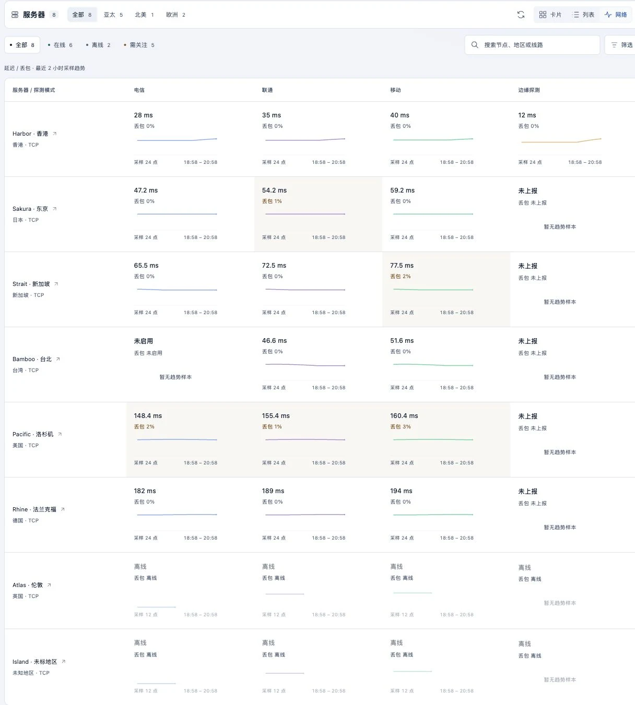

<div align="center">


# Aether · 以太

**A globe-inspired theme for CF-Server-Monitor.**

Interactive globe · Live metrics · Network quality · Dark and light modes

[Install](#install) · [Features](#features) · [Development](#development) · [简体中文](README.md)

</div>


Aether brings server locations, live statistics, compact cards and network history into one dashboard. It uses the existing [CF-Server-Monitor](https://github.com/huilang-me/CF-Server-Monitor) Worker, database, Agent and admin interface. The UI currently uses Simplified Chinese.

## Install

Use an existing CF-Server-Monitor installation with third-party theme support. Compatibility was checked against the 2.8.7 public API.

Open the admin theme/appearance settings, enter this **custom theme URL**, preview it, then apply:

```text
https://github.com/Versior/Aether-Monitor/tree/build
```

The `build` branch contains only `index.html` and `assets/`. Replace `build` with a full commit SHA from that branch to pin a version. Source code lives on `main`.

Download `aether-theme.zip` and `SHA256SUMS.txt` from [Releases](https://github.com/Versior/Aether-Monitor/releases/latest) for self-hosting. Theme-store listing depends on acceptance into the upstream index.

## Features

- Textured WebGL globe with drag rotation, inertia, flags, colored markers and expanding rings.
- Country-level server locations and a separate green visitor-location marker.
- Animated flows from server countries toward the visitor marker, with a switch to restore server-to-server arcs.
- Theme settings with visible project/solid background choices, card opacity, blur, appearance and globe motion. Saved appearance is restored before the main script loads.
- Live WebSocket metrics, resource capacity, network rates, monthly traffic and billing information.
- Card, table and network-matrix views with grouping, filters and sorting.
- Manual route tags take priority; compatible Workers can provide automatic results with ASN evidence. Enabling detection requires the [Worker update and VPS detector](https://github.com/Versior/CF-Server-Monitor/blob/main/docs/route-detection.md).
- Server overview, network, resources and asset details; historical readings support pointer, touch and keyboard input.
- Blurred offline cards with a clear status and last-sample time.
- Responsive layouts and independently tuned dark/light colors.
- Masked visitor IP, ASN, ISP, TLS, location and source-provided risk flags.
- Keyboard access and reduced-motion support.

| Dark | Light |
| --- | --- |
|  |  |



Screenshots and previews use fictional demo servers. The current demo includes ten servers covering China and both US coasts. Globe arcs are illustrative, not measured traffic links. Uptime comes from `boot_time` and is not an availability percentage. Expiry notification delivery remains the host project's responsibility.

Automatic route tags list the networks observed on the tested outbound path. A `*` marks a hop without ASN data; not observing CN2 does not rule it out. These results do not certify a provider's route tier.

## Visitor privacy

On page load, the theme reads the host's Cloudflare trace and sends the visitor's exit IP to [IPQuery](https://ipquery.io/) to obtain network metadata and risk flags. Results stay in page memory; addresses are masked by default. Add `https://api.ipquery.io` to the host's CSP API allowlist.

Risk scores are shown as provided, without converting them into a fabricated purity percentage. Failed and incomplete checks remain explicit. The local demo uses the reserved documentation address `203.0.113.71` and does not inspect the real visitor IP.

## Development

Requires Node.js 22.12+; Node.js 24 is recommended.

```bash
git clone https://github.com/Versior/Aether-Monitor.git
cd Aether-Monitor
npm ci
npm run dev
```

Open the [local preview](http://127.0.0.1:5175/). The default local demo includes ten fictional servers, historical samples and simulated updates every ten seconds. It requires no backend deployment or secrets.

```bash
npm test
npm run build
npm run package
```

The package command requires the system `zip` utility and writes the ZIP and SHA-256 checksum to `release/`. Set `API_BASE` in `.env` for a real backend or a separately hosted build; cross-origin deployments require the host's CORS and CSP configuration. Same-origin theme installation is recommended for private sites. See [configuration](docs/configuration.md).

## Contributing and license

Report reproducible bugs through [Issues](https://github.com/Versior/Aether-Monitor/issues). Include the host version, browser, viewport and steps; redact private details in screenshots. UI changes should include visual verification, and data changes should include relevant tests.

[MIT](LICENSE). Upstream utilities, textures and geographic data retain their original notices; see [third-party credits](docs/third-party-notices.md).
