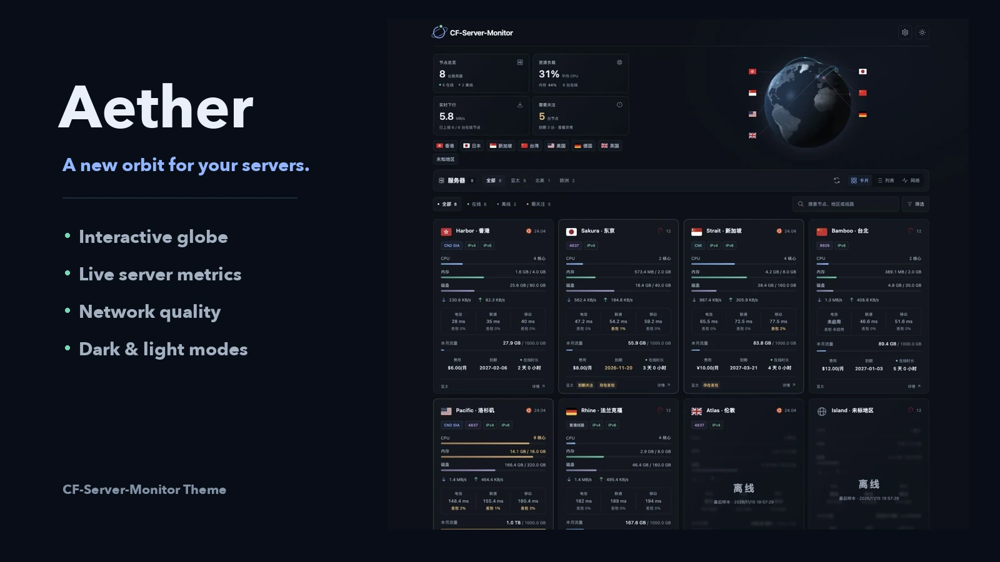
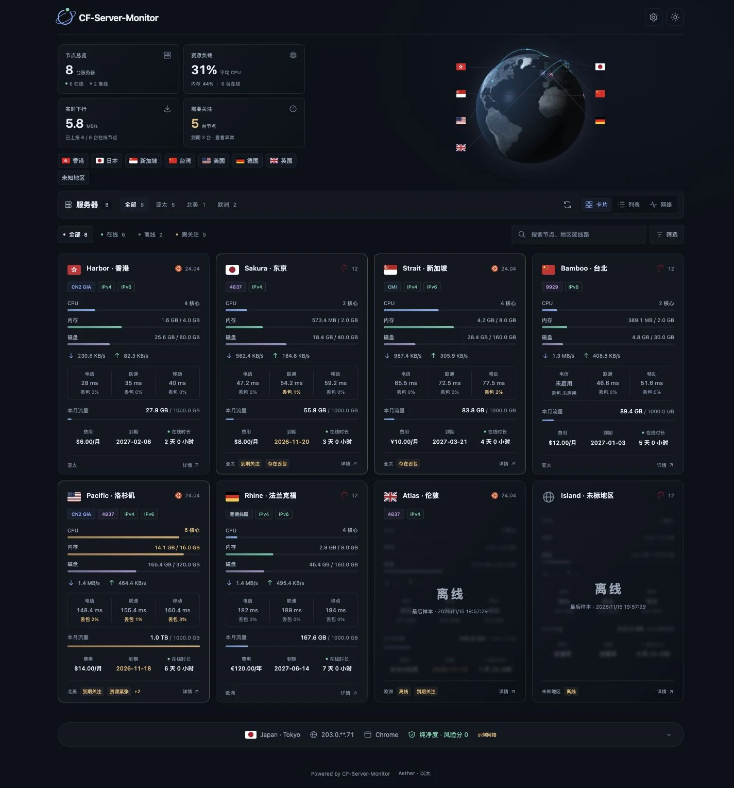
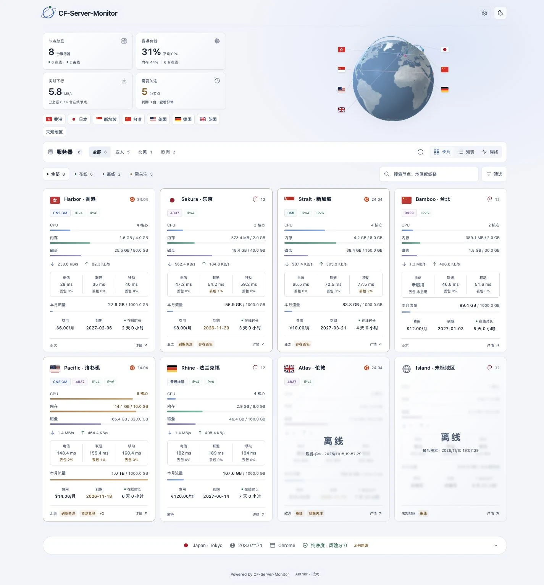

<div align="center">


# Aether · 以太

**A globe-inspired theme for CF-Server-Monitor.**

Interactive globe · Live metrics · Network quality · Dark and light modes

[Install](#install) · [Features](#features) · [Development](#development) · [简体中文](README.md)

</div>



Aether brings server locations, live statistics, compact cards and network history into one dashboard. It uses the existing [CF-Server-Monitor](https://github.com/huilang-me/CF-Server-Monitor) Worker, database, Agent and admin interface. The interface follows the site's language setting: English, Simplified Chinese or the browser language.

## Install

Use a CF-Server-Monitor installation with third-party theme support. The implementation targets [this upstream API contract](https://github.com/huilang-me/CF-Server-Monitor/blob/1e4931fbebb8dc82f113cd2da80b962fab646a3b/theme-develop.md).

Open the admin theme/appearance settings, enter this **custom theme URL**, preview it, then apply:

```text
https://github.com/Versior/Aether-Monitor/tree/build
```

`build` is the same-origin install for existing URLs, with no Worker URL baked in. Replace `build` with a full commit SHA from that branch to pin a version. `dist` holds the standalone Pages build; both branches contain only `index.html` and `assets/`. Source code lives on `main`.

Download `aether-theme.zip` and `SHA256SUMS.txt` from [Releases](https://github.com/Versior/Aether-Monitor/releases/latest) for self-hosting. Theme-store listing depends on acceptance into the upstream index.

## Features

- Textured WebGL globe with drag rotation, inertia, flags, colored markers and expanding rings.
- Country-level server locations and a separate green visitor-location marker.
- Animated flows from server countries toward the visitor marker, with a switch to restore server-to-server arcs.
- Theme settings with visible project/solid background choices, card opacity, blur, appearance and globe motion. Saved appearance is restored before the main script loads.
- Each site's node list loads once. WebSocket updates supply live metrics without REST polling. A hidden tab disconnects and fetches the current view once when it becomes visible again.
- Card, table and network-matrix views with grouping, filters and sorting.
- Manual route tags take priority; compatible Workers can provide automatic results with ASN evidence. Enabling detection requires the [Worker update and VPS detector](https://github.com/Versior/CF-Server-Monitor/blob/main/docs/route-detection.md).
- Server overview, network, resources and asset details; historical readings support pointer, touch and keyboard input.
- Blurred offline cards with a clear status and last-sample time.
- Responsive layouts and independently tuned dark/light colors.
- Optional visitor check: masked IP, ASN, ISP, location, available TLS information and source-provided risk flags.
- Keyboard access and reduced-motion support.

| Dark | Light |
| --- | --- |
|  |  |


Screenshots and previews use fictional demo servers. The current demo includes ten servers covering China and both US coasts. Globe arcs are illustrative, not measured traffic links. Uptime comes from `boot_time` and is not an availability percentage. Expiry notification delivery remains the host project's responsibility.

Automatic route tags list the networks observed on the tested outbound path. A `*` marks a hop without ASN data; not observing CN2 does not rule it out. These results do not certify a provider's route tier.

History starts at 10 minutes. A dashboard dialog reuses the list connection, while a direct detail link subscribes to that node only. The stock Worker's detail response may omit display flags: a direct visit then shows basic resources only. Opening the dashboard first loads the flags for network and asset panels. Probe timeouts remain visible; disabled or missing readings are hidden, and zero is a valid reading.

Changes made in Appearance apply immediately to the current browser. Signed-in admins can choose **Save as site defaults** to share them across browsers. For multiple Workers this saves to the first site. **Restore site defaults** clears local overrides only.

The updated companion detector also recognizes CTGNET, CUG, CMIN2 and common international networks. ASN evidence and local IP-prefix hints are shown separately, with protocol and attempt counts. Observed backbone networks are shown by name without a path-completion badge. International-only observations use an explicit transit label and do not certify a China backbone.

## Visitor privacy

No visitor lookup runs on page load or when expanding the panel. After reading the notice and choosing to run the check, the browser reads the host's Cloudflare trace and sends its exit IP to [IPQuery](https://ipquery.io/) to obtain metadata and risk flags. Results stay in page memory and addresses are masked by default. To enable the optional check, allow `https://api.ipquery.io` in `connect-src`. To restrict the site to monitor APIs, set `theme_options.aether.visitorLookup` to `false`; this removes the button. `visitorFlow` only controls animation.

Risk scores are shown as provided, without converting them into a fabricated purity percentage. Failed and incomplete checks remain explicit. The local demo uses the reserved documentation address `203.0.113.71` and does not inspect the real visitor IP.

## Development

Requires Node.js 22.12+; Node.js 24 is recommended.

```bash
git clone https://github.com/Versior/Aether-Monitor.git
cd Aether-Monitor
npm ci
npm run dev
```

Open the [local preview](http://127.0.0.1:5175/). The default local demo includes ten fictional servers, historical samples and simulated updates every ten seconds. It requires no backend deployment or secrets.

```bash
npm test
npm run build
npm run package
```

The package command requires the system `zip` utility and writes the ZIP and SHA-256 checksum to `release/`. For a separate frontend, configure `CORS_ALLOWED_ORIGINS` on **each** Worker. List the frontend origin with no path. Install the same-origin theme on private sites: logging in on a Worker does not copy its JWT to a separate static site's browser storage.

For GitHub Pages, configure the repository Actions secrets `API_BASE` (one or more Worker origins), `TITLE`, `BACKGROUND_IMAGE`, `CSP_API` and `CSP_STATIC` as needed. These settings become public in the generated Page; never include credentials. Allow Actions to write repository contents, then select **Settings → Pages → Deploy from a branch → `dist` / `(root)`** after the first build. The workflow appends to both `dist` and `build` on pushes to `main` or manual runs on `main`. GitHub's built-in `GITHUB_TOKEN` updates those branches but does not trigger a branch-based Pages rebuild. For automatic Pages publication, configure the optional `PAGES_PUBLISH_TOKEN` as a repository-only credential with Contents write access, belonging to an account eligible to publish Pages. Keep it in Actions secrets. See [deployment details](docs/configuration.md#发布结构).

## Contributing and license

Report reproducible bugs through [Issues](https://github.com/Versior/Aether-Monitor/issues). Include the host version, browser, viewport and steps; redact private details in screenshots. UI changes should include visual verification, and data changes should include relevant tests.

[MIT](LICENSE). Upstream utilities, textures and geographic data retain their original notices; see [third-party credits](docs/third-party-notices.md).
