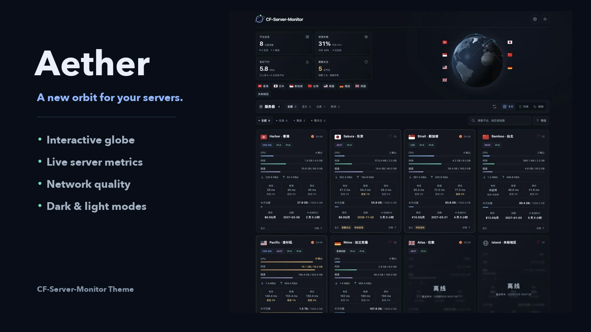
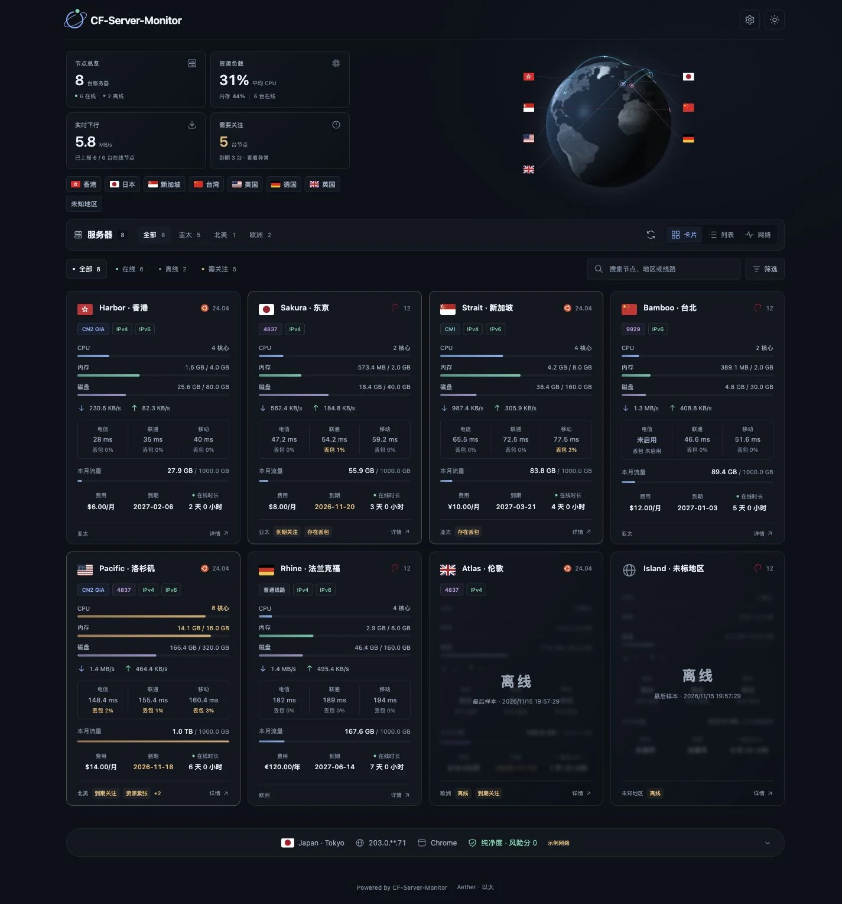
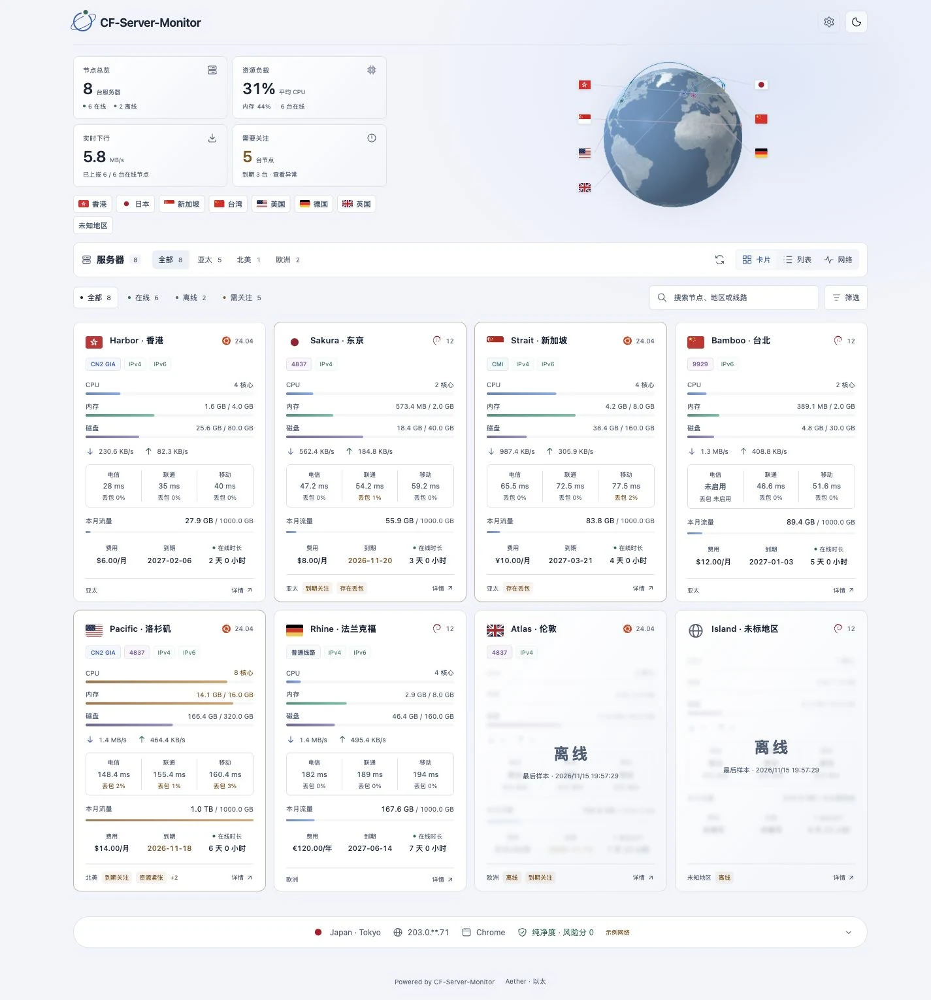
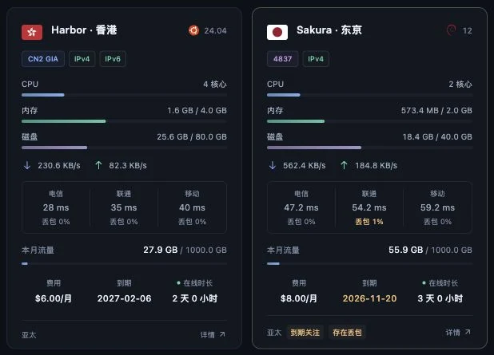
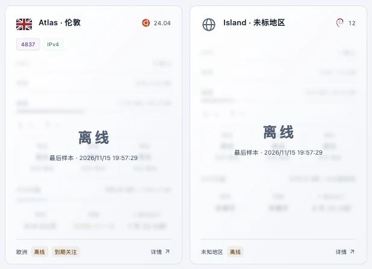
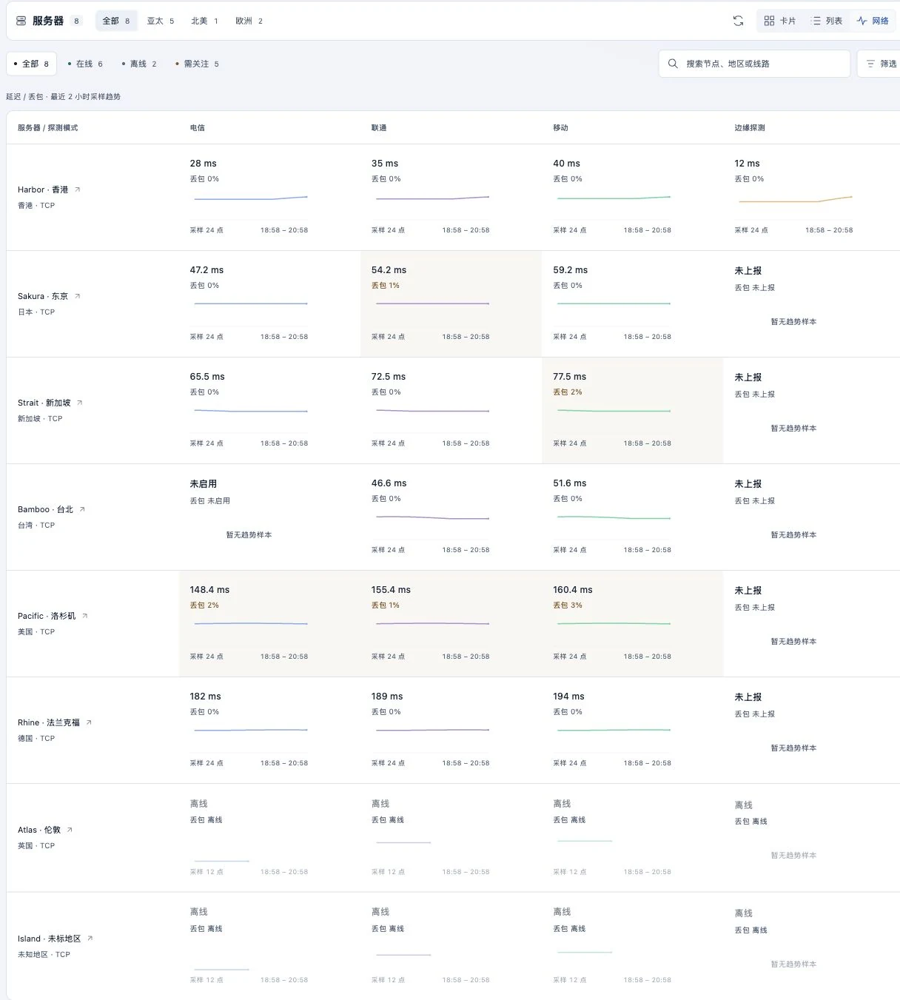
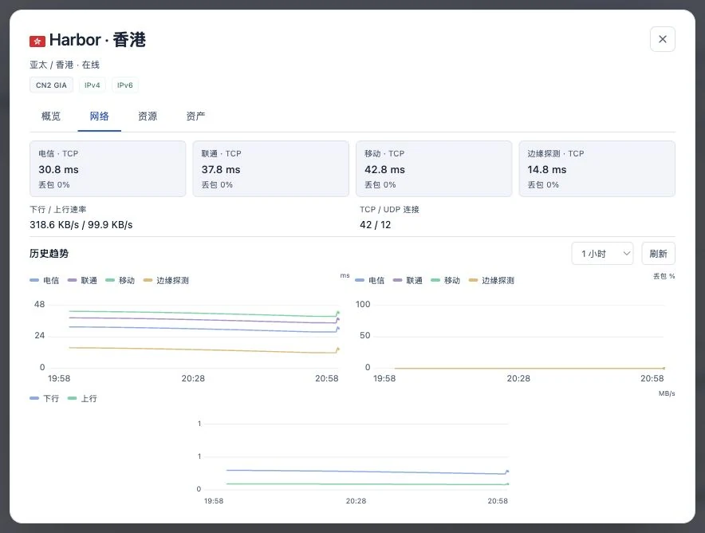
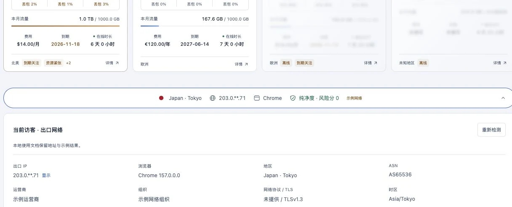
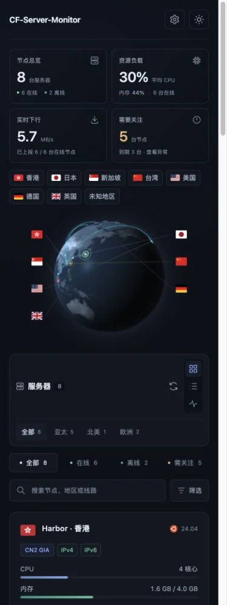
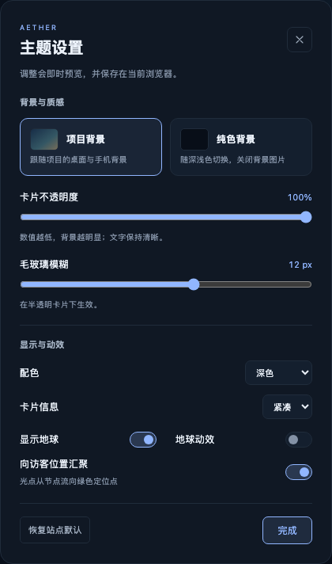

<div align="center">


# Aether · 以太

**让分散的服务器，在一张地球上清晰可见。**

为 [CF-Server-Monitor](https://github.com/huilang-me/CF-Server-Monitor) 打造的第三方主题。<br>
交互地球 · 实时指标 · 网络质量 · 深浅双主题

[](https://github.com/Versior/Aether-Monitor/releases/latest)
[](LICENSE)
[](https://vuejs.org/)
[](https://github.com/Versior/Aether-Monitor/stargazers)

[快速安装](#快速安装) · [界面预览](#界面预览) · [功能](#功能) · [本地开发](#本地开发) · [English](README.en.md)

</div>



## 为什么是 Aether

服务器的分布、运行状态和网络质量，本来就应该一起看。Aether 把实时统计、可旋转地球和紧凑节点卡片放在同一屏：先看全局，再点进细节。

它是界面主题，复用 CF-Server-Monitor 的 Worker、数据库和 Agent。安装后继续使用原来的探针和管理后台。

## 快速安装

需要已部署、支持第三方主题的 **CF-Server-Monitor**。本仓库按[上游固定版本的主题接口](https://github.com/huilang-me/CF-Server-Monitor/blob/1e4931fbebb8dc82f113cd2da80b962fab646a3b/theme-develop.md)开发；界面跟随站点的简体中文、英文或浏览器语言设置。

1. 打开监控站点的管理后台，进入主题商店／外观设置。
2. 在 **自定义主题 URL** 中填写下面的地址，先预览，再应用。
3. 回到监控首页，查看 Aether。

```text
https://github.com/Versior/Aether-Monitor/tree/build
```

`build` 是同源安装包，不绑定任何 Worker，适合私有站点；将 `build` 换成该分支的完整提交 SHA 可固定版本。`dist` 是独立静态页面，按自己的 Actions Secrets 构建。两者只含 `index.html` 与 `assets/`。[配置文档](docs/configuration.md#发布结构)有 Pages 和权限设置。

也可以从 [Releases](https://github.com/Versior/Aether-Monitor/releases/latest) 下载 **aether-theme.zip** 与校验文件。ZIP 用于自托管或主题产物分发；后台的自定义主题 URL 使用上面的 GitHub 地址。

> 当前仓库提供独立安装地址。是否出现在官方主题商店，取决于主题索引的收录状态。

## 界面预览

### 深色与浅色

白天清楚，夜晚克制。两套配色分别调整文字、状态色和地球光照。

| 深色 | 浅色 |
| --- | --- |
|  |  |

### 节点卡片

系统图标与版本、资源容量、三网延迟、流量、费用、到期日期和运行时长集中展示。离线时淡化最后样本，在卡片中央明确显示状态。

| 在线节点 | 离线节点 |
| --- | --- |
|  |  |

### 网络质量与详情

卡片、列表、网络矩阵三种视图自由切换。点击节点，可查看概览、网络、资源和资产；历史曲线支持鼠标、触摸与键盘读取采样值。



<details>
<summary>展开查看节点详情、访客网络和手机界面</summary>





<p align="center"></p>

</details>

截图与本地预览使用虚构节点。当前预览包含 **10 台服务器**，覆盖中国、美东和美西；其中的名称、价格、地址和运行指标用于演示。

## 功能

| 能力 | 你能看到什么 |
| --- | --- |
| 交互地球 | 地表纹理、拖动旋转、惯性、自转、国旗、彩色定位圈与波纹 |
| 地区分布 | 国家级节点位置；绿色定位圈表示访客 IP 归属国家 |
| 汇聚动效 | 多国节点光点流向绿色访客位置，可在主题设置中关闭 |
| 个性化设置 | 项目／纯色背景、卡片不透明度、毛玻璃、配色与地球动效 |
| 实时监控 | 首次载入列表，之后用 WebSocket 更新；页面隐藏时断开，恢复可见时同步一次 |
| 网络质量 | 三网与已配置的额外探测；延迟、丢包、历史趋势和矩阵视图 |
| 线路信息 | 手动标签优先；配套 Worker 支持时显示自动识别结果与 ASN 证据 |
| 节点资产 | 费用、账单周期、到期日期、流量额度、开机运行时长 |
| 资源详情 | Swap、连接数、进程、负载、磁盘 IO，以及有上报时的 GPU 指标 |
| 快速查找 | 分组、地区、线路、协议、异常状态、关键词和排序 |
| 访客网络 | 访客主动同意检测后，展示脱敏 IP、ASN、运营商、国家／城市、可用的 TLS 信息与风险标记 |
| 响应式布局 | 宽屏四列卡片、平板适配、手机单列，支持深浅色切换 |
| 无障碍交互 | 键盘访问、可见焦点、图表读数与减少动态效果设置 |

### 数据含义

- **地球连线是展示动效**，不表示测量到的跨服务器传输链路。节点位置属于国家／地区级示意。
- 自动线路标签列出本次观测到的 ASN 网络或 IP 段匹配结果。缺失跳标记为 `*`，未观测到 CN2 不等于已经排除 CN2；检测结果不是商家线路等级认证。
- 配套新版支持 CTGNET、CUG、CMIN2 和常见国际网络；IP 段辅助匹配与 ASN 分开显示，页面直接显示已观测的线路名称，仅见国际网络时显示“经”。
- **运行时长来自 `boot_time`**，表示本次开机时长；离线后按最后样本停止累计，不等同于连续在线可用率。
- 到期状态使用后台填写的日期。通知规则、发送渠道和自动续期逻辑由宿主负责，主题提供展示。
- 费用和相关指标遵循宿主的展示开关。缺失数据保留“未上报／未填写”，不会伪装成零。
- 详情历史默认 10 分钟。首页弹窗复用已有连接，直接打开详情只订阅该节点。如果原版宿主的详情响应没有展示开关，冷启动详情只显示基础资源；先打开首页取得开关后再看网络或资产。未启用／未采样的探测隐藏，超时与有效的零值分别展示。
- 美国节点优先使用明确的“美西／美东”分组或标签；水牛城显示美东，圣何塞和洛杉矶显示美西，其余显示北美。中国显示亚太，国家筛选与绿色访客定位显示中国。

### 主题设置

页头的“主题设置”即时调整当前浏览器。已登录管理员可另选“保存为站点默认”，让没有本机覆盖的访客使用该配置；多站点时保存到第一站。“恢复站点默认”只清除自己的覆盖。深浅色在页面主脚本加载前恢复。



## 访客 IP 与隐私

打开页面不会查询外部服务。访客第一次展开底部面板时自动检测一次；收起再展开不会重复检测，面板内仍可手动重试。浏览器先读取宿主的 `/cdn-cgi/trace`，再将出口 IP 发给 [IPQuery](https://ipquery.io/) 查询归属与风险。结果只保存在页面内存中，默认脱敏。严格限制监控接口的站点，请将 `theme_options.aether.visitorLookup` 设为 `false`，隐藏检测入口；`visitorFlow` 只控制动画。

风险分直接采用来源的 `risk_score`，不换算成“纯净百分比”。查询失败、缺失评分、代理／VPN／Tor 标记分别展示，不代表特定平台的信誉或解锁保证。

在宿主外观设置的 **CSP API 白名单** 中加入：

```text
https://api.ipquery.io
```

本地示例使用文档保留地址 `203.0.113.71`，不查询实际访客网络。详见 [配置与部署说明](docs/configuration.md)。

## 本地开发

需要 **Node.js 22.12+**；建议 Node.js 24。包管理器使用 npm，锁文件已提交。

```bash
git clone https://github.com/Versior/Aether-Monitor.git
cd Aether-Monitor
npm ci
npm run dev
```

访问 [本地预览](http://127.0.0.1:5175/)。默认启用本地示例：10 台虚构节点、历史采样和每 10 秒一次的模拟推送，无需部署 Worker 或配置密钥。示例中的后台入口会显示说明页。

```bash
npm test          # 主题行为与数据口径测试
npm run build    # 生成 dist/index.html 与 dist/assets/
npm run package  # 构建 ZIP 与 SHA256SUMS.txt，需要系统 zip 命令
```

连接自己的后端、静态托管和主题选项见 [配置文档](docs/configuration.md)。提交变更前请运行测试、构建，并在深浅色和手机尺寸下检查涉及的页面。

```text
Aether-Monitor/
├── theme/src/         # Aether 页面、地球、组件与测试
├── theme/public/      # 打包的素材许可说明
├── src/               # 复用的 CF-Server-Monitor 前端工具
├── public/            # 开发用国旗、系统图标与地理数据
├── demo/              # 本地示例，仅用于开发
├── docs/              # 截图、配置与第三方声明
└── scripts/           # 主题打包脚本
```

## 反馈与贡献

欢迎通过 [Issues](https://github.com/Versior/Aether-Monitor/issues) 报告问题或提出建议。提供宿主版本、浏览器、屏幕尺寸和复现步骤，截图中请先隐藏 IP 与其他敏感信息。

欢迎提交聚焦的 Pull Request。界面修改附上实际截图，数据逻辑修改附上对应验证结果。

## 许可与致谢

Aether 代码采用 [MIT License](LICENSE)。复用代码与素材保留各自许可和署名，详见 [第三方声明](docs/third-party-notices.md)。

- [CF-Server-Monitor](https://github.com/huilang-me/CF-Server-Monitor)：公开 API、实时连接、鉴权与前端工具。
- [Vue](https://vuejs.org/) 与 [Vite](https://vite.dev/)：页面与构建工具。
- [three.js](https://github.com/mrdoob/three.js)：地球纹理来源；地球渲染由本主题的 WebGL／Canvas 代码实现。
- [Unicode CLDR](https://github.com/unicode-org/cldr-json)：国家到大区的归类数据。
- [IPQuery](https://ipquery.io/)：访客网络归属与风险数据。

<div align="center">Aether · 以太<br><sub>为 CF-Server-Monitor 构建的一张清晰、流动的服务器地图。</sub></div>
